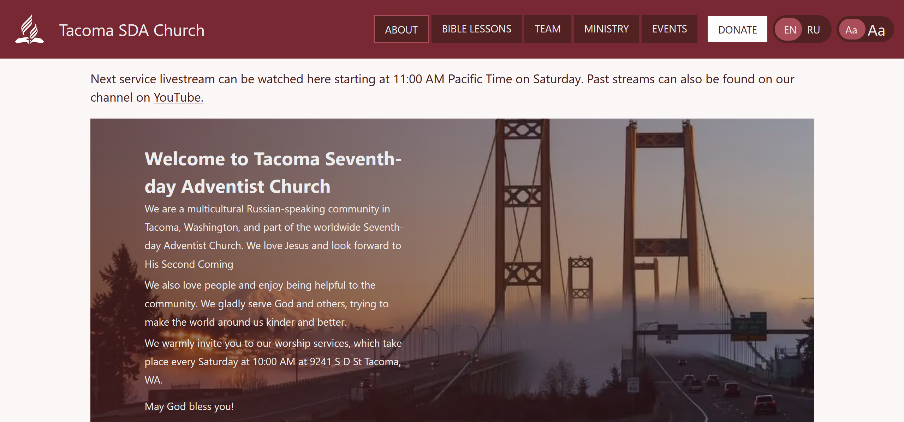
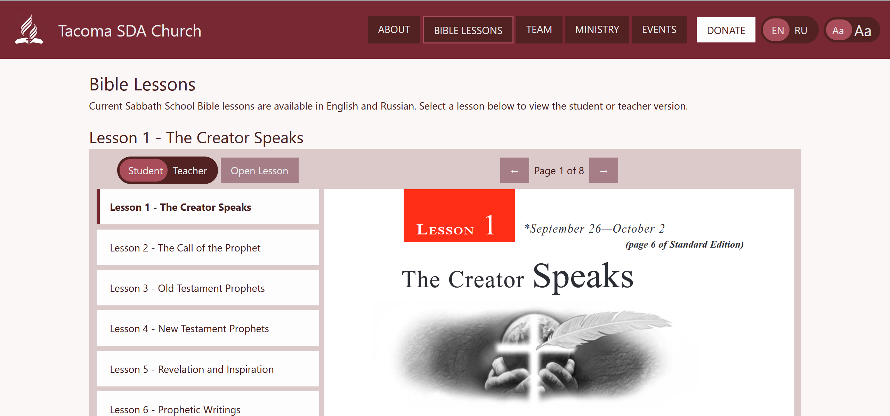
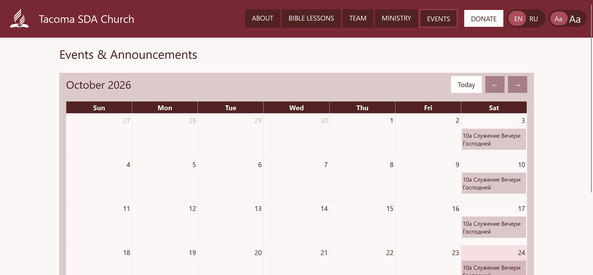
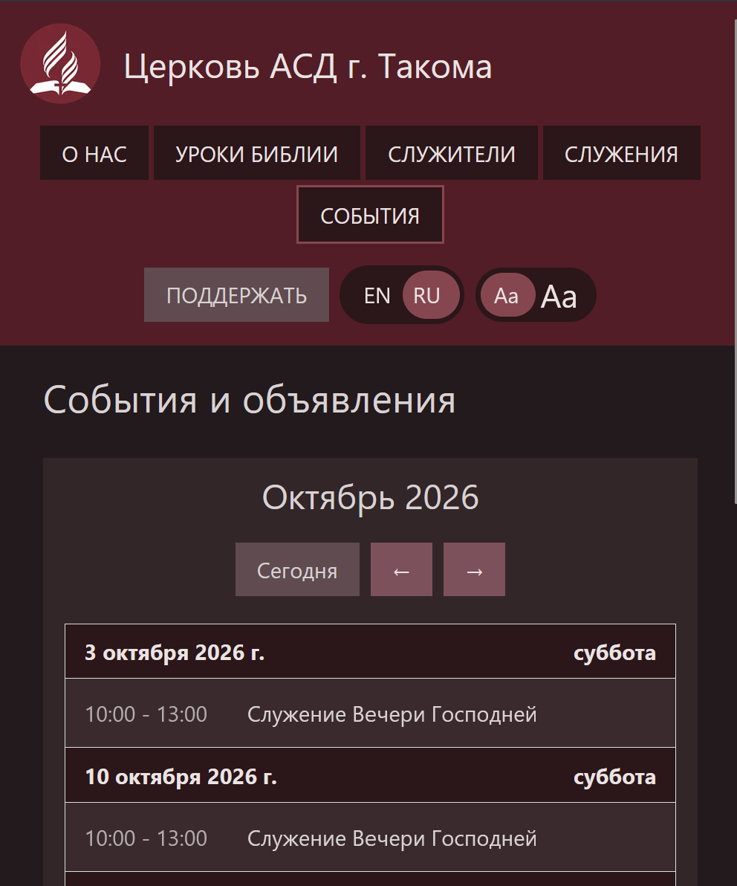

# TacomaASDWebsite
[Tacoma ASD Church](https://www.sdatacoma.com/) webiste.

This site provides access to church resources for members who are unable to attend in-person events. It features an embedded livestream during services, general information about the church, current sabbath school lessons, information about the leadership team, overview of the ministries, and a synced events calendar.

Made with Next.js and TypeScript and hosted on Vercel.

## Screenshots
### Homepage


### Bible Lessons


### Church Calendar


### Calendar (Mobile) in Dark Mode


## Features
1. Livestream Integration: Displays church's YouTube livestreams when active.
2. Bible Lessons: Embeds Sabbath School lessons and study resources.
3. Church Calendar: Shows upcoming church events and scheduled activities.
4. Bilingual Interface: Supports English and Russian content.
5. Font toggle: Provides a large font option for most text.

## Tech Stack
- **Frontend:** React, Typescript, Tailwind CSS, FullCalendar
- **Backend:** Next.js (App Router, API Routes)
- **External APIs:** YouTube, Google Calendar, Google OAuth 2.0
- **Deployment:** Vercel

## Getting Started

### Prerequisites
- Node.js: A version compatible with Next.js 16 (Node.js 20.9 or later).

### Installation

```bash
git clone https://github.com/glavavlada/TacomaASDWebsite.git
cd repo
npm install
```

### Environment Variables

Create a `.env.local` file based on `.env.example`.

| Variable | Description | Required For |
|---|---|---|
| `GOOGLE_CLIENT_ID` | Google Cloud OAuth credentials | Livestream |
| `GOOGLE_CLIENT_SECRET` | Client secret for the Google OAuth 2.0 application | Livestream |
| `YOUTUBE_REFRESH_TOKEN` | OAuth refresh token for the church's YouTube account | Livestream |
| `GOOGLE_YOUTUBE_REDIRECT_URI` | Redirect URI where Google returns the browser after OAuth authorization | Livestream |
| `GOOGLE_CALENDAR_API_KEY` | Google Calendar API key and calendar IDs | Calendar |
| `GOOGLE_CALENDAR_EN_ID` | Calendar ID for church events | Calendar |

## Usage
Visitors can browse church information and resources, view upcoming events through the church calendar, access YouTube livestreams, and study Sabbath School lessons. The bilingual interface supports both English- and Russian-speaking visitors.

## Architecture
- **Frontend:** React components built with Next.js and Tailwind CSS provide the website's user interface, bilingual content, and font sizing.
- **API Routes:** Next.js API routes handle server-side requests to external services.
- **Calendar Integration:** The application retrieves church event data from the Google Calendar API and displays it using FullCalendar.
- **Livestream Integration:** Google OAuth 2.0 credentials authorize server-side YouTube API requests to retrieve livestream information.
- **Deployment:** The application is deployed on Vercel.

## Development
Create a `.env.local` file using `.env.example` and configure the required environment variables before running the application.

Install dependencies and start the local development server:
```bash
npm install
npm run dev
```

Open http://localhost:3000.

## Known Limitations
The website language context does not translate calendar event names and details.

## Credits
### Developers
- Vladislav Glavatskii
- Evgeniia Nemynova  

### Libraries and Frameworks
- [Next.js](https://nextjs.org/) — React framework for the application.
- [React](https://react.dev/) — User interface library.
- [Tailwind CSS](https://tailwindcss.com/) — Styling and responsive layouts.
- [FullCalendar](https://fullcalendar.io/) — Interactive church calendar.
- [Framer Motion](https://motion.dev/) — Animations and transitions.
- [next-intl](https://next-intl.dev/) — Internationalization for English and Russian content.
- [React PDF](https://github.com/wojtekmaj/react-pdf) — PDF viewing.

### External Services
- [Google Calendar API](https://developers.google.com/calendar/api) — Church event data.
- [Google OAuth 2.0](https://developers.google.com/identity/protocols/oauth2) — Authorization for server-side Google API access.
- [YouTube](https://www.youtube.com/) — Church livestreams and video content.
- [Vercel](https://vercel.com/) — Website hosting and deployment.

### External Content
- [Sabbath School lessons](https://sabbath-school.adventech.io/) — Embedded Bible study lessons and resources, provided by Adventech.
